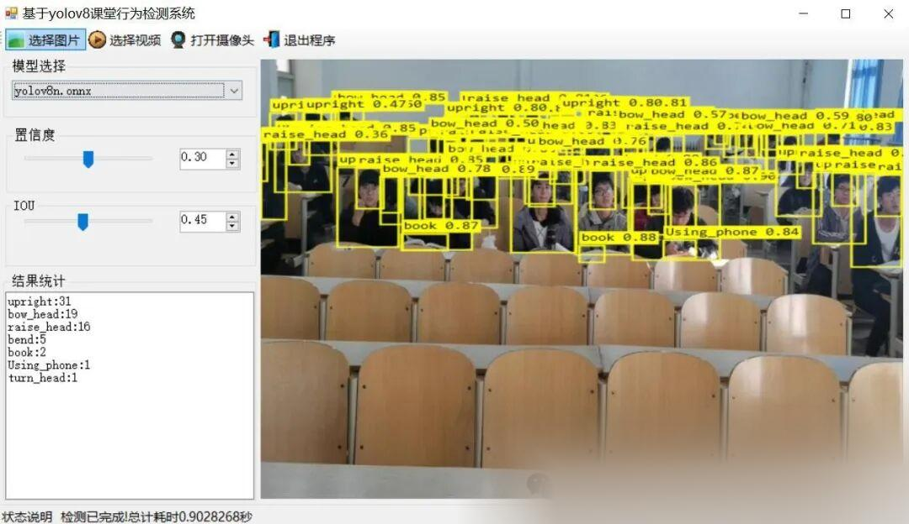
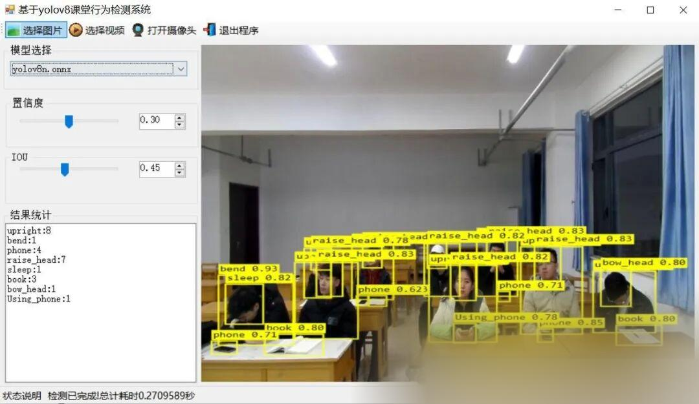
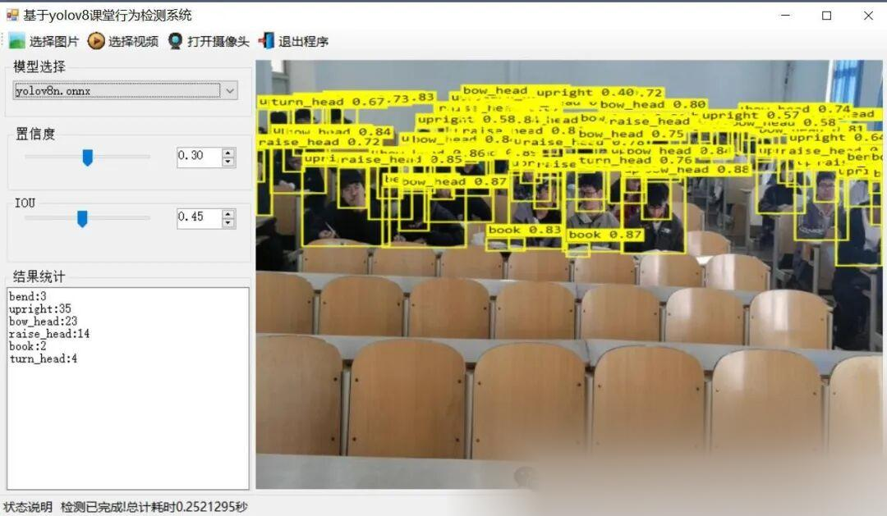

# [C#][winform] Classroom Behavior Detection System Based on YOLOv8 C# Source Code + ONNX Model + Evaluation Indicator Curve + High-quality GUI Interface

[Important Notice]

This system employs OpenCVSharp for image processing and ONNX Runtime as the inference engine, utilizing CPU for inference. It is suitable for both Windows X64 systems with or without a graphics card, and does not support macOS and Linux systems. It does not support x86 Windows operating systems. Since it uses CPU inference, it is slower than GPU-based inference. For the majority of operating systems, we have temporarily only written the CPU inference source code. The GPU inference source code may be adjusted later based on needs. Currently, we are primarily considering CPU inference, mainly to accommodate most users who are students and do not have a graphics card.

[Algorithm Introduction]

The classroom behavior detection system based on YOLOv8 is an innovative application of modern educational technology. This system utilizes the advanced deep learning algorithm YOLOv8 to achieve automatic, efficient, and precise monitoring of students' classroom behaviors. YOLOv8 is renowned for its outstanding performance and speed in the field of object detection. By conducting in-depth analysis of inputs from student video recordings or real-time cameras, the system can accurately identify various student behaviors such as raising hands, reading, writing, using mobile phones, and looking down.

This system not only enhances the efficiency and accuracy of classroom monitoring but also features real-time feedback capabilities, assisting teachers in timely adjusting teaching strategies to improve teaching quality. Through a graphical interface, teachers can conveniently view student behavior data, including types of behaviors, occurrence times, durations, etc., thereby generating detailed behavioral analysis reports.

Furthermore, The classroom behavior detection system based on YOLOv8 also has multi-scene applicability. Whether it is in the traditional classroom or online teaching environment. Can be flexibly applied. At the same time, The data collected by the system can also be used for educational decision-making and personalized teaching. For educational psychology, Research on teaching methods and other aspects provides scientific basis.

In summary, the classroom behavior detection system based on YOLOv8 brings revolutionary changes to modern education with its efficiency, accuracy, and real-time features, significantly enhancing teaching quality and learning outcomes.

[Effect Display]



 

 

[Test Environment]

Windows 10 x64 system
Visual Studio 2019
.NET Framework 4.7.2
OpenCVSharp 4.8.0
ONNX Runtime 1.16.3

The model can detect the category.

["Using_phone","bend","book","bow_head","hand-raising","phone","raise_head","reading","sleep","turn_head","upright","writing"]

[Training Dataset]

[Partial Implementation Source Code]

-
-
-
-
-
-
-
-
-
-
-
-
-
-
-
-
-
-
-
-
-
-
-
-
-
-
-
-
-
-
-
-
-
-
-
-
-
-
-
-
-
-
-
-
-
-
-
-
-
-
-
-
-
-
-
-
-
-
-
-
-
-
-
-
-
-
-
-
-
-
-
-
-
-
-
-
-
-
-
-
-
-
-
-
-
-
-
-
-
-
-
-
-
-
-
-
-
-
-
-
-
-
-
-
-
-
-
-
-
-
-
-
-
-
-
-
-
-
-
-
-
-
-
-
-
-
-
-
-
-
-
-
-
-
-
-
-
-
-
-
-
-
-
-
-
-
-
-
-
-
-
-
-
-
-
-
-
-
-
-
-
-
-
-
-
-
-
-
-
-
-
-
-
-
-
-
-
-
-
-
-
-
-
-
-
-
-
-
-
-
-
-
-
-
-
-
-
-
-
-
-
-
-
-
-
-
-
-
-
-
-
-
-
-
-
-
-
-
-
-
-
-
-
-
-
-
-
-
-
-
-
-
-
-
-
-
-
-
-
-
-
-
-
-
-
-
-
-
-
-
-
-
-
-
-
-
-
-
-
-
-
-
-
-

```
using OpenCvSharp;using System;using System.Collections.Generic;using System.ComponentModel;using System.Data;using System.Diagnostics;using System.Drawing;using System.IO;using System.Linq;using System.Text;using System.Threading;using System.Threading.Tasks;using System.Windows.Forms; namespace FIRC{    public partial class Form1 : Form    {         public bool videoStart = false;//Video stop sign        string weightsPath = Application.StartupPath + "\\weights";//Model Catalog        string labelTxt= Application.StartupPath + "\\weights\\class_names.txt";//Category file        Yolov8Manager detetor = new Yolov8Manager();//Inference engine        public Form1()        {            InitializeComponent();            CheckForIllegalCrossThreadCalls = false;//Thread updates control without error.        }        private void LoadWeightsFromDir()        {            var di = new DirectoryInfo(weightsPath);            foreach(var fi in di.GetFiles("*.onnx"))            {                comboBox1.Items.Add(fi.Name);            }            if(comboBox1.Items.Count>0)            {                comboBox1.SelectedIndex = 0;            }            else            {                tssl_show.Text = "Model not found,Please close the program, and put the model intoweightsFolder!";                tsb_pic.Enabled = false;                tsb_video.Enabled = false;                tsb_camera.Enabled = false;            }        }        private void Form1_Load(object sender, EventArgs e)        {            LoadWeightsFromDir();//Load model from directory        }        public string GetResultString(Result result)        {            Dictionary<string, int> resultDict = new Dictionary<string, int>();            for (int i = 0; i < result.length; i++)            {                if(resultDict.ContainsKey( result.classes[i]) )                {                    resultDict[result.classes[i]]++;                }                else                {                    resultDict[result.classes[i]]=1;                }            }             var resultStr = "";            foreach(var item in resultDict)            {                resultStr += string.Format("{0}:{1}\n",item.Key,item.Value);            }            return resultStr;        }        private void tsb_pic_Click(object sender, EventArgs e)        {            OpenFileDialog ofd = new OpenFileDialog();            ofd.Filter = "*.*|*.bmp;*.jpg;*.jpeg;*.tiff;*.tiff;*.png";            if (ofd.ShowDialog() != DialogResult.OK) return;            tssl_show.Text = "Detecting......";            Task.Run(() => {                var sw = new Stopwatch();                sw.Start();                Mat image = Cv2.ImRead(ofd.FileName);                detetor.Confidence =Convert.ToSingle(numericUpDown1.Value);                detetor.IOU = Convert.ToSingle(numericUpDown2.Value);                var results=detetor.Inference(image);                                var resultImage = detetor.DrawImage(OpenCvSharp.Extensions.BitmapConverter.ToBitmap(image), results);                    sw.Stop();                pb_show.Image = resultImage;                tb_res.Text = GetResultString(results);                tssl_show.Text = "Test completed!Total time spent"+sw.Elapsed.TotalSeconds+"Second";            });                     }         public void VideoProcess(string videoPath)        {            Task.Run(() => {                 detetor.Confidence = Convert.ToSingle(numericUpDown1.Value);                detetor.IOU = Convert.ToSingle(numericUpDown2.Value);                VideoCapture capture = new VideoCapture(videoPath);                if (!capture.IsOpened())                {                    tssl_show.Text="Video failed to open!";                    return;                }                Mat frame = new Mat();                var sw = new Stopwatch();                int fps = 0;                while (videoStart)                {                     capture.Read(frame);                    if (frame.Empty())                    {                        Console.WriteLine("data is empty!");                        break;                    }                    sw.Start();                    var results = detetor.Inference(frame);                    var resultImg = detetor.DrawImage(frame,results);                    sw.Stop();                    fps = Convert.ToInt32(1 / sw.Elapsed.TotalSeconds);                    sw.Reset();                    Cv2.PutText(resultImg, "FPS=" + fps, new OpenCvSharp.Point(30, 30), HersheyFonts.HersheyComplex, 1.0, new Scalar(255, 0, 0), 3);                    //Display results                    pb_show.Image = OpenCvSharp.Extensions.BitmapConverter.ToBitmap(resultImg);                    tb_res.Text = GetResultString(results);                    Thread.Sleep(5);                  }                 capture.Release();                 pb_show.Image = null;                tssl_show.Text = "Video has stopped.!";                tsb_video.Text = "Select video";             });        }        public void CameraProcess(int cameraIndex=0)        {            Task.Run(() => {                 detetor.Confidence = Convert.ToSingle(numericUpDown1.Value);                detetor.IOU = Convert.ToSingle(numericUpDown2.Value);                VideoCapture capture = new VideoCapture(cameraIndex);                if (!capture.IsOpened())                {                    tssl_show.Text = "Camera failed to open!";                    return;                }                Mat frame = new Mat();                var sw = new Stopwatch();                int fps = 0;                while (videoStart)                {                     capture.Read(frame);                    if (frame.Empty())                    {                        Console.WriteLine("data is empty!");                        break;                    }                    sw.Start();                    var results = detetor.Inference(frame);                    var resultImg = detetor.DrawImage(frame, results);                    sw.Stop();                    fps = Convert.ToInt32(1 / sw.Elapsed.TotalSeconds);                    sw.Reset();                    Cv2.PutText(resultImg, "FPS=" + fps, new OpenCvSharp.Point(30, 30), HersheyFonts.HersheyComplex, 1.0, new Scalar(255, 0, 0), 3);                    //Display results                    pb_show.Image = OpenCvSharp.Extensions.BitmapConverter.ToBitmap(resultImg);                    tb_res.Text = GetResultString(results);                    Thread.Sleep(5);                  }                 capture.Release();                 pb_show.Image = null;                tssl_show.Text = "Camera has stopped!";                tsb_camera.Text = "Turn on the camera";             });        }        private void tsb_video_Click(object sender, EventArgs e)        {            if(tsb_video.Text=="Select video")            {                OpenFileDialog ofd = new OpenFileDialog();                ofd.Filter = "Video files(*.*)|*.mp4;*.avi";                if (ofd.ShowDialog() != DialogResult.OK) return;                videoStart = true;                VideoProcess(ofd.FileName);                tsb_video.Text = "Stop";                tssl_show.Text = "Video is being detected....";             }            else            {                videoStart = false;                           }        }         private void tsb_camera_Click(object sender, EventArgs e)        {            if (tsb_camera.Text == "Open the camera")            {                videoStart = true;                CameraProcess(0);                tsb_camera.Text = "Stop";                tssl_show.Text = "Camera is in detection mode....";             }            else            {                videoStart = false;             }        }         private void tsb_exit_Click(object sender, EventArgs e)        {            videoStart = false;            this.Close();        }         private void trackBar1_Scroll(object sender, EventArgs e)        {            numericUpDown1.Value = Convert.ToDecimal(trackBar1.Value / 100.0f);        }         private void trackBar2_Scroll(object sender, EventArgs e)        {            numericUpDown2.Value = Convert.ToDecimal(trackBar2.Value / 100.0f);        }         private void numericUpDown1_ValueChanged(object sender, EventArgs e)        {            trackBar1.Value = (int)(Convert.ToSingle(numericUpDown1.Value) * 100);        }         private void numericUpDown2_ValueChanged(object sender, EventArgs e)        {            trackBar2.Value = (int)(Convert.ToSingle(numericUpDown2.Value) * 100);        }         private void comboBox1_SelectedIndexChanged(object sender, EventArgs e)        {            tssl_show.Text="Load model:"+comboBox1.Text;            detetor.LoadWeights(weightsPath+"\\"+comboBox1.Text,labelTxt);            tssl_show.Text = "Model loading is complete.!";        }    }}
```

[Usage Steps]

Usage Steps:
1. First, install the YOLOv8 environment according to the official framework https://github.com/ultralytics/ultralytics and convert your own PT model into ONNX model using the official export command.
2. Open the Sln project in VS2019, select x64 release, and modify some necessary parameters such as input shape, etc. Click Run to view the final result.

Please note that if there are any runtime errors, refer to my blog for re-invoking the DLL of my source code: [C#] OpenCVSharp error System.Memory, Version=4.0.1.2, Culture=neutral, PublicKeyToken=cc7b13fcd2ddd51 "Version higher than the referenced_ failed to load file or assembly" "system.memory, version=4.0.1.2, culture-CSDN blog

[Provided Files]

C# Source Code
YOLOv8n.onnx Model (No PyTorch model provided)
Training Map, P, R Curve Plots (in weights\results.png)
Test Images (under test_img folder)

[Source code download link]

Follow WeChat Official Account [Future Autonomous Research Center] and reply with "firc10" to get the download method.


## Payment

Here is a pay link on Stripe ( https://buy.stripe.com/3cs8yP7sY87d0vu9AB ). Please contact me lonlonago@foxmail.com after funding $89, and I will send you a complete data files , thank you!


